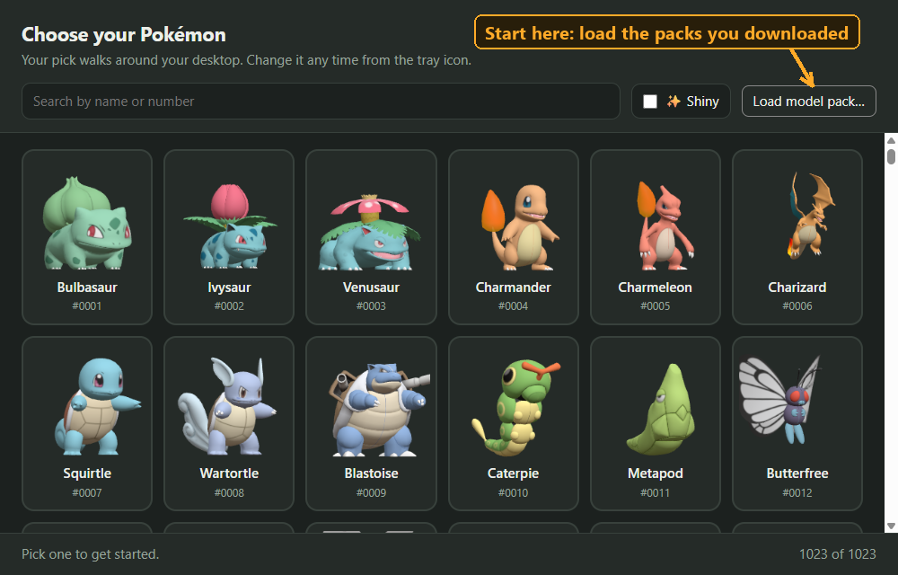

# Pokémon Desktop Pet

A little Pokémon that walks around the bottom of your screen. It naps, eats, follows your mouse, and wanders
between monitors if you have more than one. Windows only. It uses hardly any CPU.

Fan project, not affiliated with Nintendo, Game Freak or The Pokémon Company. The models belong to them.
If they ask me to take this down, I will.


## Install

1. Grab `PokemonDesktopPet_1.0.0_x64-setup.exe` from the [releases page](../../releases/latest) and run it.
   Windows will probably warn you about an unknown publisher (I haven't paid for a code-signing certificate).
   Click "More info", then "Run anyway".
2. Download some model packs from the same page. There's one per generation, plus a "Regional and Forms" pack
   with Alolan/Galarian/Hisuian/Paldean forms, Megas, Unown letters and the like. They're big (roughly 200 MB to
   1.5 GB), so you only need the ones you want. No need to unzip them.
3. Open the app and hit **Load model pack…** in the picker. Select your zips. The big ones take a minute.
4. Click a Pokémon and it'll start walking around.



## Using it

- Right-click the tray icon for the menu (change Pokémon, shiny, multi-monitor walking, quit). Left-clicking
  it, or starting the app again, brings the picker back.
- The search box takes a name or a dex number.
- If you've loaded the forms pack, Pokémon with other forms get a **Form** menu in the picker.
- Models without a shiny version just show their normal colours.


Packs get copied to `%APPDATA%\dev.local.fuecocopet\models`. To get rid of everything, uninstall the app and
delete that folder.

## Building it yourself

You need Node, Rust and the usual Tauri v2 setup for Windows.

```
npm install
npx tauri dev
npx tauri build
```

The installer doesn't contain any models. In dev builds it also picks up loose `.glb` files from a `pack/` folder.

### Pack format

A pack is a zip of `.glb` files named `SSSS[_fNN[_dN]][_shiny].glb`: `SSSS` is the dex number, `_fNN` the form,
`_dN` an optional extra variant (Alcremie's sweets). The base form has no suffix. An optional `index.json` in the
zip maps file names to display names for the Form menu. Models need `Idle` and `Walk` animations at least.

## Where things are

- `src-tauri/src/main.rs`: window, tray, monitors, settings, pack import
- `src/pet.js`: behaviour and rendering (three.js)
- `src/model.js`: sizing, blinking, the Charizard flame
- `src/picker.js`: the picker window
- `src/displays.js`: multi-monitor layout, tested with `npm test`

## Licence

The code is MIT. The model packs aren't covered by it. three.js in `src/vendor` is MIT too, by its authors.
