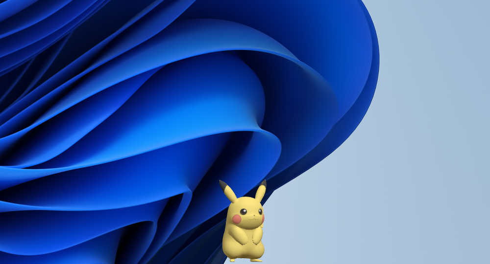
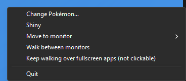
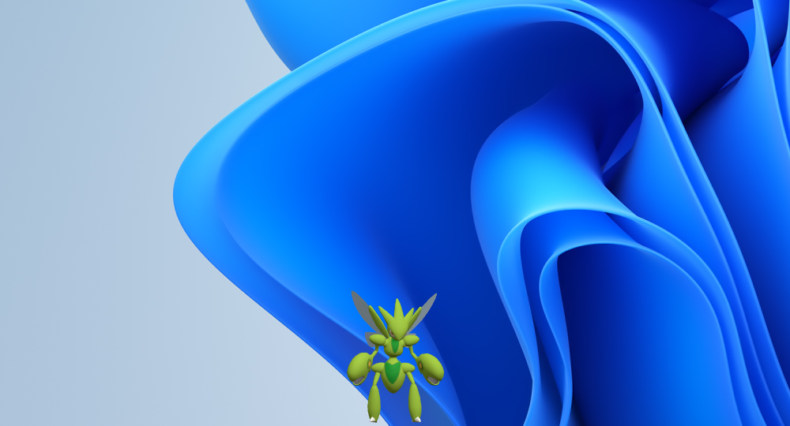

# Pokémon Desktop Pet

A little Pokémon that walks around the bottom of your screen. It naps, eats, follows your mouse, and wanders
between monitors if you have more than one. Windows only. It uses hardly any CPU.



Fan project, not affiliated with Nintendo, Game Freak or The Pokémon Company. The models belong to them.


## Where the models come from

The models were taken from the games' own 3D files (Pokémon Sword/Shield and Scarlet/Violet) and converted to
`.glb` with a converter I wrote for a separate project. Every model has the idle and walking animations the games
ship with, and most also have eating and sleeping ones, so the pet moves the way the Pokémon does in game. The app itself has no models
in it. You download them as packs and load them (see below).

They aren't perfect yet:

- Some regular colour palettes and some eyes are wrong. A few have flat or missing eye detail, and some forms have
  a palette that doesn't match the game.
- I'm fixing these slowly. Fixes go into the model files first and then into new packs, so you'll need to
  download a pack again to get a fix. Release notes will say what changed.
- A few models are held back until they look right. Bombirdier and Gholdengo aren't in the packs yet.
- Alcremie's base forms are missing their regular colours, so they're left out. Its 63 cream and sweet variants
  are in the forms pack.
- Only a handful of models have been checked by eye so far. The rest have only been checked automatically.

If something looks off, open an issue with the Pokémon, form and whether it's shiny.

## Install

1. Grab `PokemonDesktopPet_1.0.0_x64-setup.exe` from the [releases page](../../releases/latest) and run it.
   Windows will probably warn you about an unknown publisher (I haven't paid for a code-signing certificate).
   Click "More info", then "Run anyway".
2. Download some model packs from the same page. They're big (roughly 200 MB to 1.5 GB), so you only need the
   ones you want. No need to unzip them.
3. Open the app and hit **Load model pack…** in the picker. Select your zips. The big ones take a minute.
4. Click a Pokémon and it'll start walking around.


### Packs

| Pack | Pokémon | Size |
|---|---|---|
| `PokemonPet-Gen1.zip` | Kanto, 151 | 278 MB |
| `PokemonPet-Gen2.zip` | Johto, 100 | 252 MB |
| `PokemonPet-Gen3.zip` | Hoenn, 135 | 297 MB |
| `PokemonPet-Gen4.zip` | Sinnoh, 107 | 281 MB |
| `PokemonPet-Gen5.zip` | Unova, 156 | 290 MB |
| `PokemonPet-Gen6.zip` | Kalos, 72 | 219 MB |
| `PokemonPet-Gen7.zip` | Alola, 88 | 281 MB |
| `PokemonPet-Gen8.zip` | Galar and Hisui, 95 | 315 MB |
| `PokemonPet-Gen9.zip` | Paldea, 118 | 812 MB |
| `PokemonPet-Regional-and-Forms.zip` | 422 other forms | 1.5 GB |

The generation packs only hold each Pokémon's normal form, so Kanto Rattata is in Gen 1 and Alolan Rattata is
only in the forms pack. The forms pack has the Alolan, Galarian, Hisuian and Paldean forms, Megas, Unown letters,
seasonal forms and so on. Every model comes in a regular and a shiny version.

## Using it



Right-click the tray icon (it may be under the little arrow next to the clock) for the menu. Left-clicking it, or
starting the app again, brings the picker back.

- **Change Pokémon…** opens the picker. The search box takes a name or a dex number (`char`, `25`, `#150`).
- **Shiny** switches to the shiny colours. A model without a shiny version just stays in its normal colours.



- **Move to monitor** (more than one monitor only). Sends the pet to the monitor you pick.
- **Walk between monitors** (more than one monitor only). On by default. The pet now and then walks off the
  edge of its screen and onto the next one. Turn it off and it stays where it is.
- **Keep walking over fullscreen apps (not clickable)**. Off by default. See the next section.
- **Start with Windows**. Off by default. Adds or removes the app's entry in your Windows startup apps, so the
  pet appears when you sign in. It starts straight into the tray and only opens the picker the very first time.
- **Quit** closes it.

Forms aren't in the tray menu. Pokémon that have other forms loaded get a **Form** menu in the picker, next to the
Shiny box.

### What it does and the rules it follows

- It walks along the bottom of the screen, on top of the taskbar if you have one showing, or on the screen
  edge if the taskbar auto-hides. It naps now and then, eats, plays and stretches. A Charizard's tail flame is
  animated.
- It chases your mouse, but only while the cursor is on the screen it's on, or on one right next to it.
- Click it to pet it, or to wake it up if it's asleep. Drag it to pick it up and let go to drop it. It falls
  and lands.
- **It stays out of the way of fullscreen apps.** If a game or a video is fullscreen on the monitor it's on, it
  moves to the nearest monitor that doesn't have one. If every monitor has a fullscreen app, it hides until one
  of them isn't.
- With **Keep walking over fullscreen apps** turned on it doesn't hide in that case. It stays visible on top of
  the fullscreen app and keeps walking, but it ignores the mouse completely, so it never gets in the way of a
  game or steals a click.
- Maximised windows don't count as fullscreen, even frameless ones like Discord. Only a window that covers the
  whole monitor without being maximised does (games, fullscreen video).
- If you unplug the monitor it's on, it moves to your main one. If you change your monitor setup it works out the
  new layout on its own.
- Only one copy runs at a time. Starting the app a second time just opens the picker.

Models you've loaded are copied to `%APPDATA%\dev.local.fuecocopet\models`, and your choices (Pokémon, form,
shiny, the two monitor options) are saved next to it in `settings.json`. To get rid of everything, uninstall the
app and delete that folder.

## Building it yourself

You need Node, Rust and the usual Tauri v2 setup for Windows.

```
npm install
npx tauri dev
npx tauri build
```

Built with Tauri (Rust and WebView2) for the window, tray and monitor handling, and three.js for the 3D.
The installer doesn't contain any models. In dev builds it also picks up loose `.glb` files from a `pack/` folder.

### Pack format

A pack is a zip of `.glb` files named `SSSS[_fNN[_dN]][_shiny].glb`: `SSSS` is the dex number, `_fNN` the form,
`_dN` an optional extra variant (Alcremie's sweets). The base form has no suffix. An optional `index.json` in the
zip maps file names to display names for the Form menu. Models need `Idle` and `Walk` animations at least.

### Where things are

- `src-tauri/src/main.rs`: window, tray, monitors, fullscreen detection, settings, pack import
- `src/pet.js`: behaviour and rendering (three.js)
- `src/model.js`: sizing, blinking, the Charizard flame
- `src/picker.js`: the picker window
- `src/displays.js`: multi-monitor layout, tested with `npm test`

## Licence

The code is MIT. The model packs aren't covered by it. three.js in `src/vendor` is MIT too, by its authors.
